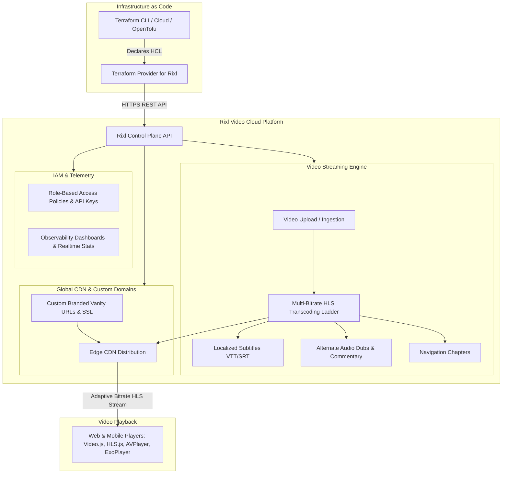

# Terraform Provider for Rixl: Video Streaming, HLS Transcoding & Media Cloud Infrastructure

[](https://registry.terraform.io/providers/rixlhq/rixl/latest)
[](https://github.com/rixlhq/terraform-provider-rixl/releases)
[](https://github.com/rixlhq/terraform-provider-rixl/actions/workflows/ci.yml)
[](https://goreportcard.com/report/github.com/rixlhq/terraform-provider-rixl)
[](LICENSE)
[](https://registry.terraform.io/providers/rixlhq/rixl/latest/docs)

The **Rixl Terraform Provider** enables platform engineers, media architects, and DevOps teams to declare, deploy, and manage video streaming pipelines and media infrastructure as code on [Rixl](https://rixl.com).

Automate video ingestion, multi-bitrate HLS (HTTP Live Streaming) transcoding ladders, multi-track audio, localized subtitles (WebVTT/SRT), timecoded chapters, image processing, custom CDN streaming domains, fine-grained IAM policies, and real-time observability telemetry.

---

## Table of Contents

- [Architecture Diagram](#architecture-diagram)
- [Key Capabilities](#key-capabilities)
- [Official Architectural Guides](#official-architectural-guides)
- [Provider Installation & Quickstart](#provider-installation--quickstart)
- [Authentication Options](#authentication-options)
- [Production Terraform Recipes](#production-terraform-recipes)
  - [1. End-to-End Automated Video Streaming Pipeline](#1-end-to-end-automated-video-streaming-pipeline)
  - [2. Custom CDN Streaming Domain & SSL Setup](#2-custom-cdn-streaming-domain--ssl-setup)
  - [3. Content Feeds, Playlists & Media Posts](#3-content-feeds-playlists--media-posts)
  - [4. Least-Privilege IAM Access Policies & API Keys](#4-least-privilege-iam-access-policies--api-keys)
  - [5. Observability Dashboard & Viewer Telemetry](#5-observability-dashboard--viewer-telemetry)
- [Resource & Data Source Reference](#resource--data-source-reference)
- [Importing Existing Infrastructure](#importing-existing-infrastructure)
- [Frequently Asked Questions (FAQ)](#frequently-asked-questions-faq)
- [Development & Contributing](#development--contributing)

---

## Architecture Diagram



---

## Key Capabilities

- **Automated Multi-Bitrate HLS Encoding**: Upload raw source MP4/MOV files and automatically receive adaptive bitrate ladders (1080p, 720p, 480p, 360p) with instant poster thumbnail generation.
- **Accessible & Internationalized Streaming**: Add multi-language WebVTT/SRT subtitles and alternate audio dubs or director commentary tracks declaratively.
- **Interactive Player Navigation**: Attach timecoded chapter markers for timeline scrubbing and topic-based seeking.
- **Branded Streaming Domains**: Serve HLS manifests, video segments, and images via custom branded domains (e.g., `stream.example.com`) with automated SSL/TLS certificate lifecycle management.
- **Content Syndication Feeds**: Group videos into structured feeds, curated playlists, and multimedia posts with audience notifications.
- **Enterprise IAM & Security**: Define least-privilege role-based access policies (RBAC), machine-to-machine OAuth2 client credentials, and long-lived API keys.
- **Observability & Analytics**: Deploy custom operational dashboards with timeseries charts, retention heatmaps, hot segments, and bandwidth tracking.

---

## Official Architectural Guides

Read our comprehensive operational walkthroughs in the [Terraform Registry](https://registry.terraform.io/providers/rixlhq/rixl/latest/docs):

- [**Getting Started with Rixl**](https://registry.terraform.io/providers/rixlhq/rixl/latest/docs/guides/getting-started): Initial setup, provider configuration, authentication, and provisioning your first project.
- [**Automated Video Streaming Pipeline**](https://registry.terraform.io/providers/rixlhq/rixl/latest/docs/guides/video-streaming-pipeline): End-to-end HLS video transcoding, audio tracks, subtitles, chapters, and player integration.
- [**Custom CDN Streaming Domains & SSL**](https://registry.terraform.io/providers/rixlhq/rixl/latest/docs/guides/custom-domains-and-cdn): Custom vanity URLs, DNS verification, automated SSL certificates, and domain auto-join.
- [**Content Feeds, Playlists & Media Distribution**](https://registry.terraform.io/providers/rixlhq/rixl/latest/docs/guides/content-feeds-and-distribution): Structured video channels, curated playlists, rich media posts, and blog notifications.
- [**IAM, RBAC, and Security Automation**](https://registry.terraform.io/providers/rixlhq/rixl/latest/docs/guides/iam-and-security): Principle of least privilege, machine-to-machine OAuth2 credentials, and enterprise SSO connections.
- [**Observability, Telemetry, and Analytics**](https://registry.terraform.io/providers/rixlhq/rixl/latest/docs/guides/monitoring-and-analytics): Dashboards, viewer retention heatmaps, hot segments, and bandwidth monitoring.

---

## Provider Installation & Quickstart

```terraform
terraform {
  required_version = ">= 1.5.0"
  required_providers {
    rixl = {
      source  = "rixlhq/rixl"
      version = "~> 1.7"
    }
  }
}

provider "rixl" {
  api_key = var.rixl_api_key # or export RIXL_API_KEY
}
```

---

## Authentication Options

### 1. Static API Key Authentication (Recommended for CI/CD)

```terraform
provider "rixl" {
  api_key = var.rixl_api_key # or set RIXL_API_KEY environment variable
}
```

### 2. OAuth2 Bearer Token Authentication (Workload Identity Federation)

```terraform
provider "rixl" {
  bearer_token = var.rixl_bearer_token # or set RIXL_BEARER_TOKEN environment variable
}
```

### Environment Variables Reference

| Variable | Description | Sensitive | Default |
| :--- | :--- | :--- | :--- |
| `RIXL_API_KEY` | Rixl personal or service API key (`X-API-Key` header) | Yes | &mdash; |
| `RIXL_BEARER_TOKEN` | OAuth2 / Workload Identity Bearer token (`Authorization` header) | Yes | &mdash; |
| `RIXL_BASE_URL` | Rixl API base endpoint | No | `https://api.rixl.com` |

---

## Production Terraform Recipes

### 1. End-to-End Automated Video Streaming Pipeline

Provision a production project, upload an MP4/MOV video asset with automated HLS transcoding, attach localized subtitles, add an alternative audio track, and configure interactive scrub-bar chapters:

```terraform
variable "org_id" {
  type        = string
  description = "Rixl Organization ID"
}

# 1. Project environment
resource "rixl_project" "vod_prod" {
  org_id = var.org_id
  name   = "production-vod"
}

# 2. Upload video asset (initiates multi-bitrate HLS ladder transcoding)
resource "rixl_video" "keynote" {
  project_id       = rixl_project.vod_prod.id
  name             = "Global Keynote 2026"
  file_path        = "${path.module}/media/keynote.mp4"
  poster_file_path = "${path.module}/media/poster.jpg"
}

# 3. Add localized subtitles
resource "rixl_subtitle" "keynote_es" {
  project_id    = rixl_project.vod_prod.id
  video_id      = rixl_video.keynote.id
  language_code = "es"
  label         = "Español"
  file_path     = "${path.module}/media/subtitles_es.vtt"
}

# 4. Attach an alternative commentary audio track
resource "rixl_audio_track" "director_cut" {
  project_id    = rixl_project.vod_prod.id
  video_id      = rixl_video.keynote.id
  language_code = "en"
  label         = "Director Commentary"
  file_path     = "${path.module}/media/commentary.aac"
}

# 5. Define interactive chapters for player navigation
resource "rixl_video_chapters" "keynote_chapters" {
  project_id = rixl_project.vod_prod.id
  video_id   = rixl_video.keynote.id

  chapters = [
    {
      title          = "Opening Remarks"
      start_time_sec = 0.0
    },
    {
      title          = "Product Announcements"
      start_time_sec = 75.5
    },
    {
      title          = "Live Demonstration"
      start_time_sec = 180.0
    },
    {
      title          = "Q&A and Closing"
      start_time_sec = 320.0
    },
  ]
}
```

### 2. Custom CDN Streaming Domain & SSL Setup

Configure a branded vanity domain, map it to a project, and define corporate email domain auto-join:

```terraform
# Register custom domain
resource "rixl_custom_domain" "cdn" {
  org_id = var.org_id
  domain = "stream.example.com"
}

# Map domain to project
resource "rixl_project_custom_domain" "cdn_mapping" {
  org_id        = var.org_id
  project_id    = rixl_project.vod_prod.id
  custom_domain = rixl_custom_domain.cdn.domain
}

# Auto-join rule for verified corporate users
resource "rixl_domain_auto_join" "corp_onboarding" {
  org_id  = var.org_id
  enabled = true
}
```

### 3. Content Feeds, Playlists & Media Posts

Organize media assets into channels and publish articles with subscriber notifications:

```terraform
variable "user_id" {
  type        = string
  description = "Rixl User ID"
}

# Curated video channel
resource "rixl_feed" "tech_talks" {
  project_id   = rixl_project.vod_prod.id
  name         = "tech-talks"
  description  = "Engineering deep dives and architecture reviews"
  allow_videos = true
  allow_images = false
}

# Multimedia post
resource "rixl_post" "architecture_review" {
  project_id  = rixl_project.vod_prod.id
  feed_id     = rixl_feed.tech_talks.id
  video_id    = rixl_video.keynote.id
  description = "Deep Dive: Cloud Transcoding Architecture - Overview of how multi-bitrate HLS streams are packaged."
}

# Webhook / email subscriber preference
resource "rixl_blog_subscription" "alerts" {
  user_id    = var.user_id
  subscribed = true
}
```

### 4. Least-Privilege IAM Access Policies & API Keys

Enforce granular role-based access control and generate service account credentials:

```terraform
# Define least-privilege policy for CI/CD runners
resource "rixl_access_policy" "pipeline_policy" {
  org_id      = var.org_id
  name        = "MediaPipelineUploader"
  description = "Allows automated CI/CD runners to upload video assets and chapters"
  permissions = [
    "video:read",
    "video:write",
    "subtitle:write",
    "audio_track:write",
  ]
}

# Issue API key for CI/CD automation runner
resource "rixl_api_key" "ci_runner" {
  org_id     = var.org_id
  project_id = rixl_project.vod_prod.id
  name       = "github-actions-uploader"
}
```

### 5. Observability Dashboard & Viewer Telemetry

Create custom telemetry monitoring dashboards with timeseries metric widgets:

```terraform
resource "rixl_dashboard" "streaming_ops" {
  name       = "Streaming Operations & Telemetry"
  visibility = "org"
}

resource "rixl_dashboard_widget" "viewer_sessions" {
  dashboard_id = rixl_dashboard.streaming_ops.id
  title        = "Concurrent Streaming Sessions"
  chart_type   = "timeseries"
  dataset      = "playback"
  metric       = "concurrent_sessions"
  pos_x        = 0
  pos_y        = 0
  width        = 6
  height       = 4
}
```

---

## Importing Existing Infrastructure

Existing Rixl resources can be imported into Terraform state seamlessly using `terraform import`:

```bash
# Import a project by its unique ID
terraform import rixl_project.vod_prod "proj_01hxxxxxxxxx"

# Import an uploaded video asset
terraform import rixl_video.keynote "vid_01hxxxxxxxxx"

# Import a custom streaming domain
terraform import rixl_custom_domain.cdn "dom_01hxxxxxxxxx"

# Import an IAM access policy
terraform import rixl_access_policy.pipeline_policy "pol_01hxxxxxxxxx"

# Import a content feed
terraform import rixl_feed.tech_talks "feed_01hxxxxxxxxx"
```

---

## Frequently Asked Questions (FAQ)

### What video formats and codecs does Rixl support?
Rixl ingests MP4, MOV, MKV, AVI, and WebM container formats encoded with standard codecs (H.264 / AVC, H.265 / HEVC, VP9, AV1). The transcoding pipeline converts uploads into standard multi-bitrate HLS (m3u8 playlists and fMP4 / MPEG-TS segments) compatible with all modern browsers, mobile devices, and OTT players.

### Can I stream video assets through my own custom domain?
Yes. Using `rixl_custom_domain` and `rixl_project_custom_domain`, you can route all streaming playback manifests, segments, poster images, and subtitle files through a custom branded domain (e.g., `stream.company.com`). Rixl automatically provisions and manages TLS/SSL certificates once DNS ownership is verified.

### How does the provider handle asynchronous video transcoding?
When creating a `rixl_video` resource, the provider securely uploads the media binary and tracks processing status. Rixl's asynchronous transcoding engine performs encoding in the cloud without blocking Terraform operations, returning valid playback IDs immediately.

### Are sensitive credentials masked in Terraform state and logs?
Yes. All credentials&mdash;including `api_key`, `bearer_token`, and generated client secrets&mdash;are marked with `Sensitive = true` in the Terraform Plugin Framework schema, preventing exposure in CLI outputs, CI/CD logs, and plan diffs.

---

## Development & Contributing

### Prerequisites

- [Go](https://go.dev/doc/install) >= 1.26
- [Terraform](https://developer.hashicorp.com/terraform/downloads) >= 1.5
- [mise](https://mise.jdx.dev/) tool manager

### Common Commands

```bash
# Format codebase
mise run fmt

# Run unit tests with code coverage
mise run test

# Run linter suite (golangci-lint)
mise run lint

# Generate and validate documentation
mise run docs
mise run docs-check
```

---

## Resource & Data Source Reference

| Category | Resource Types | Data Source Types |
| :--- | :--- | :--- |
| **Video & Media** | [`rixl_video`](https://registry.terraform.io/providers/rixlhq/rixl/latest/docs/resources/video), [`rixl_video_chapters`](https://registry.terraform.io/providers/rixlhq/rixl/latest/docs/resources/video_chapters), [`rixl_subtitle`](https://registry.terraform.io/providers/rixlhq/rixl/latest/docs/resources/subtitle), [`rixl_audio_track`](https://registry.terraform.io/providers/rixlhq/rixl/latest/docs/resources/audio_track), [`rixl_image`](https://registry.terraform.io/providers/rixlhq/rixl/latest/docs/resources/image) | `rixl_video`, `rixl_videos`, `rixl_video_stats`, `rixl_video_heatmap`, `rixl_video_hot_segments`, `rixl_top_videos`, `rixl_image`, `rixl_images`, `rixl_image_stats`, `rixl_top_images`, `rixl_chapters`, `rixl_subtitles`, `rixl_audio_tracks`, `rixl_languages` |
| **Projects & Content** | [`rixl_project`](https://registry.terraform.io/providers/rixlhq/rixl/latest/docs/resources/project), [`rixl_feed`](https://registry.terraform.io/providers/rixlhq/rixl/latest/docs/resources/feed), [`rixl_post`](https://registry.terraform.io/providers/rixlhq/rixl/latest/docs/resources/post), [`rixl_blog_subscription`](https://registry.terraform.io/providers/rixlhq/rixl/latest/docs/resources/blog_subscription) | `rixl_project`, `rixl_projects`, `rixl_feed`, `rixl_feeds`, `rixl_feed_stats`, `rixl_top_feeds`, `rixl_post`, `rixl_posts`, `rixl_post_stats`, `rixl_top_posts`, `rixl_blog_subscription` |
| **Custom Domains** | [`rixl_custom_domain`](https://registry.terraform.io/providers/rixlhq/rixl/latest/docs/resources/custom_domain), [`rixl_project_custom_domain`](https://registry.terraform.io/providers/rixlhq/rixl/latest/docs/resources/project_custom_domain), [`rixl_domain_auto_join`](https://registry.terraform.io/providers/rixlhq/rixl/latest/docs/resources/domain_auto_join) | `rixl_domain`, `rixl_domain_auto_join` |
| **IAM & Security** | [`rixl_access_policy`](https://registry.terraform.io/providers/rixlhq/rixl/latest/docs/resources/access_policy), [`rixl_policy_attachment`](https://registry.terraform.io/providers/rixlhq/rixl/latest/docs/resources/policy_attachment), [`rixl_api_key`](https://registry.terraform.io/providers/rixlhq/rixl/latest/docs/resources/api_key), [`rixl_client_credential`](https://registry.terraform.io/providers/rixlhq/rixl/latest/docs/resources/client_credential), [`rixl_auth_provider_connection`](https://registry.terraform.io/providers/rixlhq/rixl/latest/docs/resources/auth_provider_connection) | `rixl_policy`, `rixl_policies`, `rixl_policy_attachments`, `rixl_user_policies`, `rixl_api_keys`, `rixl_client_credentials`, `rixl_providers`, `rixl_passkeys`, `rixl_permission_registries` |
| **Organizations** | [`rixl_organization`](https://registry.terraform.io/providers/rixlhq/rixl/latest/docs/resources/organization), [`rixl_organization_invitation`](https://registry.terraform.io/providers/rixlhq/rixl/latest/docs/resources/organization_invitation), [`rixl_organization_member`](https://registry.terraform.io/providers/rixlhq/rixl/latest/docs/resources/organization_member) | `rixl_organization_members`, `rixl_memberships`, `rixl_membership_applications`, `rixl_check_membership`, `rixl_internal_membership_info`, `rixl_user`, `rixl_user_info` |
| **Dashboards & Telemetry** | [`rixl_dashboard`](https://registry.terraform.io/providers/rixlhq/rixl/latest/docs/resources/dashboard), [`rixl_dashboard_widget`](https://registry.terraform.io/providers/rixlhq/rixl/latest/docs/resources/dashboard_widget) | `rixl_dashboard`, `rixl_dashboards`, `rixl_dashboard_datasets`, `rixl_dashboard_stats`, `rixl_realtime_stats`, `rixl_storage_usage`, `rixl_storage_usage_history`, `rixl_bandwidth_usage`, `rixl_bandwidth_usage_history` |
| **Billing & Subscriptions** | [`rixl_subscription`](https://registry.terraform.io/providers/rixlhq/rixl/latest/docs/resources/subscription), [`rixl_payment_method`](https://registry.terraform.io/providers/rixlhq/rixl/latest/docs/resources/payment_method), [`rixl_billing_address`](https://registry.terraform.io/providers/rixlhq/rixl/latest/docs/resources/billing_address) | `rixl_subscription`, `rixl_subscription_history`, `rixl_plan`, `rixl_plans`, `rixl_invoices`, `rixl_payment_methods`, `rixl_payment_method_from_payment_intent`, `rixl_payment_method_from_setup_intent`, `rixl_billing_address` |

---

## License

This project is licensed under the [MIT License](LICENSE).
