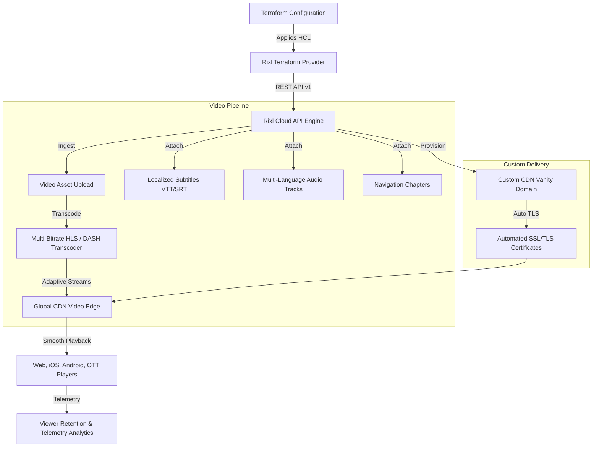

# Terraform Provider for Rixl: Video Streaming, HLS Transcoding & Media Cloud Infrastructure

[](https://registry.terraform.io/providers/rixlhq/rixl/latest)
[](https://github.com/rixlhq/terraform-provider-rixl/releases)
[](https://github.com/rixlhq/terraform-provider-rixl/actions/workflows/ci.yml)
[](https://goreportcard.com/report/github.com/rixlhq/terraform-provider-rixl)
[](LICENSE)
[](https://registry.terraform.io/providers/rixlhq/rixl/latest/docs)

The official **Rixl Terraform Provider** enables platform engineers, media architects, and DevOps teams to declare, provision, and automate video streaming pipelines, media asset workflows, and cloud infrastructure as code (IaC) on [Rixl](https://rixl.com).

Rixl delivers a developer-first media platform featuring automated multi-bitrate HLS (HTTP Live Streaming) and DASH transcoding, adaptive bitrate delivery, custom CDN streaming domains, timecoded video navigation chapters, multi-language subtitles (WebVTT / SRT), alternative audio tracks, responsive image processing, content syndication feeds, granular IAM policies, and real-time observability telemetry.

---

## Table of Contents

- [Why Rixl with Terraform?](#why-rixl-with-terraform)
- [Architecture Overview](#architecture-overview)
- [Key Capabilities](#key-capabilities)
- [Guides & Architectural Walkthroughs](#guides--architectural-walkthroughs)
- [Overview of Resources & Data Sources](#overview-of-resources--data-sources)
- [Quickstart & Provider Configuration](#quickstart--provider-configuration)
  - [API Key Authentication (Recommended)](#api-key-authentication-recommended)
  - [OAuth2 / Bearer Token Authentication](#oauth2--bearer-token-authentication)
  - [Environment Variables Reference](#environment-variables-reference)
- [Production Terraform Recipes](#production-terraform-recipes)
  - [1. End-to-End Automated Video Streaming Pipeline](#1-end-to-end-automated-video-streaming-pipeline)
  - [2. Custom CDN Streaming Domain & SSL Setup](#2-custom-cdn-streaming-domain--ssl-setup)
  - [3. Content Feeds, Playlists & Media Posts](#3-content-feeds-playlists--media-posts)
  - [4. Least-Privilege IAM Access Policies & API Keys](#4-least-privilege-iam-access-policies--api-keys)
  - [5. Observability Dashboard & Viewer Retention Heatmaps](#5-observability-dashboard--viewer-retention-heatmaps)
- [Importing Existing Infrastructure](#importing-existing-infrastructure)
- [Frequently Asked Questions (FAQ)](#frequently-asked-questions-faq)
- [Development & Contributing](#development--contributing)
- [License](#license)

---

## Why Rixl with Terraform?

- **Infrastructure as Code for Video**: Replace manual web console clicking with repeatable, auditable, and version-controlled Terraform modules.
- **Automated Multi-Bitrate HLS Transcoding**: Upload source video files and automatically generate adaptive bitrate profiles (1080p, 720p, 480p, 360p) optimized for global mobile and desktop playback.
- **Zero-Drift Environments**: Keep production, staging, and development media projects identical and detect unauthorized configuration drift.
- **Enterprise Security & Compliance**: Manage granular role-based access control (RBAC), machine-to-machine OAuth2 client credentials, and enterprise SSO connections natively.
- **Observability as Code**: Provision operational telemetry dashboards and viewer engagement metrics alongside your streaming infrastructure.

---

## Architecture Overview



---

## Key Capabilities

- **Video & Audio Transcoding**: Declare video assets with automatic multi-bitrate HLS ladder encoding, poster thumbnails, localized subtitle tracks, and alternate audio streams.
- **Interactive Video Chapters**: Provide structured, timecoded chapters for seamless scrub-bar navigation and improved viewer engagement.
- **Custom CDN Streaming Domains**: Stream videos directly under your branded vanity domain (`video.yourdomain.com`) with automated SSL/TLS provisioning and renewal.
- **Content Feeds & Syndication**: Create curated video channels, mixed-media playlists, and publish rich media posts with webhook subscriber notifications.
- **Granular IAM & Service Accounts**: Define least-privilege RBAC policies, generate scoped API keys for automation pipelines, and register OAuth2 client credentials.
- **Real-Time Observability**: Deploy telemetry dashboards tracking audience retention heatmaps, video hot segments, bandwidth consumption, and storage metrics.
- **Subscription & Quota Management**: Automate organization billing tiers, payment methods, and monitor quota limits.

---

## Guides & Architectural Walkthroughs

Explore comprehensive tutorials and architectural patterns on the [Terraform Registry](https://registry.terraform.io/providers/rixlhq/rixl/latest/docs):

| Guide | Description | Target Keywords |
| :--- | :--- | :--- |
| [**Getting Started with Rixl**](https://registry.terraform.io/providers/rixlhq/rixl/latest/docs/guides/getting-started) | Installation, provider setup, credentials, and first project provisioning | `quickstart`, `authentication`, `api-keys`, `projects` |
| [**Automated Video Streaming Pipeline**](https://registry.terraform.io/providers/rixlhq/rixl/latest/docs/guides/video-streaming-pipeline) | End-to-end HLS video transcoding, custom CDN domain, subtitles, audio tracks, and chapters | `video-streaming`, `hls-transcoding`, `adaptive-bitrate`, `vod` |
| [**Custom CDN Streaming Domains & SSL**](https://registry.terraform.io/providers/rixlhq/rixl/latest/docs/guides/custom-domains-and-cdn) | Vanity streaming URLs, DNS verification, automated SSL/TLS certificates, and project routing | `custom-domains`, `vanity-url`, `video-cdn`, `tls-ssl` |
| [**Content Feeds, Playlists & Media Distribution**](https://registry.terraform.io/providers/rixlhq/rixl/latest/docs/guides/content-feeds-and-distribution) | Structured channels, curated video playlists, rich posts, responsive images, and notifications | `content-feeds`, `playlists`, `media-syndication`, `posts` |
| [**IAM, RBAC, and Security Automation**](https://registry.terraform.io/providers/rixlhq/rixl/latest/docs/guides/iam-and-security) | Least-privilege access policies, machine-to-machine OAuth2 credentials, and enterprise SSO | `iam`, `rbac`, `security`, `oauth2`, `sso` |
| [**Observability, Telemetry, and Analytics**](https://registry.terraform.io/providers/rixlhq/rixl/latest/docs/guides/monitoring-and-analytics) | Telemetry dashboards, audience retention heatmaps, hot segments, and bandwidth metrics | `observability`, `video-analytics`, `telemetry`, `heatmaps` |

---

## Overview of Resources & Data Sources

| Category | Resources | Data Sources |
| :--- | :--- | :--- |
| **Video & Media** | [`rixl_video`](https://registry.terraform.io/providers/rixlhq/rixl/latest/docs/resources/video), [`rixl_video_chapters`](https://registry.terraform.io/providers/rixlhq/rixl/latest/docs/resources/video_chapters), [`rixl_subtitle`](https://registry.terraform.io/providers/rixlhq/rixl/latest/docs/resources/subtitle), [`rixl_audio_track`](https://registry.terraform.io/providers/rixlhq/rixl/latest/docs/resources/audio_track), [`rixl_image`](https://registry.terraform.io/providers/rixlhq/rixl/latest/docs/resources/image) | `rixl_video`, `rixl_videos`, `rixl_video_stats`, `rixl_video_heatmap`, `rixl_video_hot_segments`, `rixl_top_videos`, `rixl_image`, `rixl_images`, `rixl_image_stats`, `rixl_top_images`, `rixl_chapters`, `rixl_subtitles`, `rixl_audio_tracks`, `rixl_languages` |
| **Projects & Content** | [`rixl_project`](https://registry.terraform.io/providers/rixlhq/rixl/latest/docs/resources/project), [`rixl_feed`](https://registry.terraform.io/providers/rixlhq/rixl/latest/docs/resources/feed), [`rixl_post`](https://registry.terraform.io/providers/rixlhq/rixl/latest/docs/resources/post), [`rixl_blog_subscription`](https://registry.terraform.io/providers/rixlhq/rixl/latest/docs/resources/blog_subscription) | `rixl_project`, `rixl_projects`, `rixl_feed`, `rixl_feeds`, `rixl_feed_stats`, `rixl_top_feeds`, `rixl_post`, `rixl_posts`, `rixl_post_stats`, `rixl_top_posts`, `rixl_blog_subscription` |
| **Custom Domains** | [`rixl_custom_domain`](https://registry.terraform.io/providers/rixlhq/rixl/latest/docs/resources/custom_domain), [`rixl_project_custom_domain`](https://registry.terraform.io/providers/rixlhq/rixl/latest/docs/resources/project_custom_domain), [`rixl_domain_auto_join`](https://registry.terraform.io/providers/rixlhq/rixl/latest/docs/resources/domain_auto_join) | `rixl_domain`, `rixl_domain_auto_join` |
| **Identity & Access (IAM)** | [`rixl_access_policy`](https://registry.terraform.io/providers/rixlhq/rixl/latest/docs/resources/access_policy), [`rixl_policy_attachment`](https://registry.terraform.io/providers/rixlhq/rixl/latest/docs/resources/policy_attachment), [`rixl_api_key`](https://registry.terraform.io/providers/rixlhq/rixl/latest/docs/resources/api_key), [`rixl_client_credential`](https://registry.terraform.io/providers/rixlhq/rixl/latest/docs/resources/client_credential), [`rixl_auth_provider_connection`](https://registry.terraform.io/providers/rixlhq/rixl/latest/docs/resources/auth_provider_connection) | `rixl_policy`, `rixl_policies`, `rixl_policy_attachments`, `rixl_user_policies`, `rixl_api_keys`, `rixl_client_credentials`, `rixl_providers`, `rixl_passkeys`, `rixl_permission_registries` |
| **Organizations** | [`rixl_organization`](https://registry.terraform.io/providers/rixlhq/rixl/latest/docs/resources/organization), [`rixl_organization_invitation`](https://registry.terraform.io/providers/rixlhq/rixl/latest/docs/resources/organization_invitation), [`rixl_organization_member`](https://registry.terraform.io/providers/rixlhq/rixl/latest/docs/resources/organization_member) | `rixl_organization_members`, `rixl_memberships`, `rixl_membership_applications`, `rixl_check_membership`, `rixl_internal_membership_info`, `rixl_user`, `rixl_user_info` |
| **Observability** | [`rixl_dashboard`](https://registry.terraform.io/providers/rixlhq/rixl/latest/docs/resources/dashboard), [`rixl_dashboard_widget`](https://registry.terraform.io/providers/rixlhq/rixl/latest/docs/resources/dashboard_widget) | `rixl_dashboard`, `rixl_dashboards`, `rixl_dashboard_datasets`, `rixl_dashboard_stats`, `rixl_realtime_stats`, `rixl_storage_usage`, `rixl_storage_usage_history`, `rixl_bandwidth_usage`, `rixl_bandwidth_usage_history` |
| **Billing & Subscriptions** | [`rixl_subscription`](https://registry.terraform.io/providers/rixlhq/rixl/latest/docs/resources/subscription), [`rixl_payment_method`](https://registry.terraform.io/providers/rixlhq/rixl/latest/docs/resources/payment_method), [`rixl_billing_address`](https://registry.terraform.io/providers/rixlhq/rixl/latest/docs/resources/billing_address) | `rixl_subscription`, `rixl_subscription_history`, `rixl_plan`, `rixl_plans`, `rixl_invoices`, `rixl_payment_methods`, `rixl_payment_method_from_payment_intent`, `rixl_payment_method_from_setup_intent`, `rixl_billing_address` |

---

## Quickstart & Provider Configuration

### API Key Authentication (Recommended)

```terraform
terraform {
  required_version = ">= 1.5.0"
  required_providers {
    rixl = {
      source  = "rixlhq/rixl"
      version = "~> 1.7"
    }
  }
}

provider "rixl" {
  api_key = var.rixl_api_key # or set RIXL_API_KEY environment variable
}
```

### OAuth2 / Bearer Token Authentication

```terraform
provider "rixl" {
  bearer_token = var.rixl_bearer_token # or set RIXL_BEARER_TOKEN environment variable
}
```

### Environment Variables Reference

| Variable | Description | Sensitive | Default |
| :--- | :--- | :--- | :--- |
| `RIXL_API_KEY` | Rixl personal or service API key (`X-API-Key` header) | Yes | &mdash; |
| `RIXL_BEARER_TOKEN` | OAuth2 / Workload Identity Bearer token (`Authorization` header) | Yes | &mdash; |
| `RIXL_BASE_URL` | Rixl API base endpoint | No | `https://api.rixl.com` |

---

## Production Terraform Recipes

### 1. End-to-End Automated Video Streaming Pipeline

Provision a production project, upload an MP4/MOV video asset with automated HLS transcoding, attach localized subtitles, add an alternative audio track, and configure interactive scrub-bar chapters:

```terraform
variable "org_id" {
  type        = string
  description = "Rixl Organization ID"
}

# 1. Project environment
resource "rixl_project" "vod_prod" {
  org_id = var.org_id
  name   = "production-vod"
}

# 2. Upload video asset (initiates multi-bitrate HLS ladder transcoding)
resource "rixl_video" "keynote" {
  project_id       = rixl_project.vod_prod.id
  name             = "Global Keynote 2026"
  file_path        = "${path.module}/media/keynote.mp4"
  poster_file_path = "${path.module}/media/poster.jpg"
}

# 3. Add localized subtitles
resource "rixl_subtitle" "keynote_es" {
  project_id = rixl_project.vod_prod.id
  video_id   = rixl_video.keynote.id
  language   = "es"
  label      = "Español"
  file_path  = "${path.module}/media/subtitles_es.vtt"
}

# 4. Attach an alternative commentary audio track
resource "rixl_audio_track" "director_cut" {
  project_id = rixl_project.vod_prod.id
  video_id   = rixl_video.keynote.id
  language   = "en"
  label      = "Director Commentary"
  file_path  = "${path.module}/media/commentary.aac"
}

# 5. Define interactive chapters for player navigation
resource "rixl_video_chapters" "keynote_chapters" {
  project_id = rixl_project.vod_prod.id
  video_id   = rixl_video.keynote.id

  chapters = [
    {
      title      = "Opening Remarks"
      start_time = 0.0
    },
    {
      title      = "Product Announcements"
      start_time = 75.5
    },
    {
      title      = "Live Demonstration"
      start_time = 180.0
    },
    {
      title      = "Q&A and Closing"
      start_time = 320.0
    },
  ]
}
```

### 2. Custom CDN Streaming Domain & SSL Setup

Configure a branded vanity domain, map it to a project, and define corporate email domain auto-join:

```terraform
# Register custom domain
resource "rixl_custom_domain" "cdn" {
  org_id = var.org_id
  domain = "stream.example.com"
}

# Map domain to project
resource "rixl_project_custom_domain" "cdn_mapping" {
  project_id = rixl_project.vod_prod.id
  domain_id  = rixl_custom_domain.cdn.id
}

# Auto-join rule for verified corporate users
resource "rixl_domain_auto_join" "corp_onboarding" {
  org_id    = var.org_id
  domain    = "example.com"
  role_name = "Editor"
}
```

### 3. Content Feeds, Playlists & Media Posts

Organize media assets into channels and publish articles with subscriber notifications:

```terraform
# Curated video channel
resource "rixl_feed" "tech_talks" {
  project_id   = rixl_project.vod_prod.id
  name         = "tech-talks"
  description  = "Engineering deep dives and architecture reviews"
  allow_videos = true
  allow_images = false
}

# Multimedia post
resource "rixl_post" "architecture_review" {
  project_id = rixl_project.vod_prod.id
  title      = "Deep Dive: Cloud Transcoding Architecture"
  content    = "An overview of how multi-bitrate HLS streams are packaged and distributed via edge CDN nodes."
  status     = "published"
}

# Webhook / email subscriber
resource "rixl_blog_subscription" "alerts" {
  project_id = rixl_project.vod_prod.id
  email      = "streaming-team@example.com"
  active     = true
}
```

### 4. Least-Privilege IAM Access Policies & API Keys

Enforce granular role-based access control and generate service account credentials:

```terraform
# Define least-privilege policy for CI/CD runners
resource "rixl_access_policy" "pipeline_policy" {
  org_id      = var.org_id
  name        = "MediaPipelineUploader"
  description = "Allows automated CI/CD runners to upload video assets and chapters"
  rules = [
    {
      action   = "video:write"
      resource = "project:${rixl_project.vod_prod.id}/*"
      effect   = "allow"
    },
    {
      action   = "chapters:write"
      resource = "project:${rixl_project.vod_prod.id}/*"
      effect   = "allow"
    },
  ]
}

# Issue API key for CI/CD automation runner
resource "rixl_api_key" "ci_runner" {
  org_id      = var.org_id
  name        = "github-actions-uploader"
  description = "Scoped API key for media ingestion runner"
}
```

### 5. Observability Dashboard & Viewer Retention Heatmaps

Create custom telemetry monitoring dashboards with audience retention heatmap widgets:

```terraform
resource "rixl_dashboard" "streaming_ops" {
  org_id      = var.org_id
  title       = "Streaming Operations & Telemetry"
  description = "Real-time bandwidth, viewer retention, and transcoding status"
}

resource "rixl_dashboard_widget" "viewer_heatmap" {
  dashboard_id = rixl_dashboard.streaming_ops.id
  title        = "Audience Retention Heatmap"
  widget_type  = "heatmap"
  query        = "video.retention.percentile"
  row          = 0
  col          = 0
  width        = 6
  height       = 4
}
```

---

## Importing Existing Infrastructure

Existing Rixl resources can be imported into Terraform state seamlessly using `terraform import`:

```bash
# Import a project by its unique ID
terraform import rixl_project.vod_prod "proj_01hxxxxxxxxx"

# Import an uploaded video asset
terraform import rixl_video.keynote "vid_01hxxxxxxxxx"

# Import a custom streaming domain
terraform import rixl_custom_domain.cdn "dom_01hxxxxxxxxx"

# Import an IAM access policy
terraform import rixl_access_policy.pipeline_policy "pol_01hxxxxxxxxx"

# Import a content feed
terraform import rixl_feed.tech_talks "feed_01hxxxxxxxxx"
```

---

## Frequently Asked Questions (FAQ)

### What video formats and codecs does Rixl support?
Rixl ingests MP4, MOV, MKV, AVI, and WebM container formats encoded with standard codecs (H.264 / AVC, H.265 / HEVC, VP9, AV1). The transcoding pipeline converts uploads into standard multi-bitrate HLS (m3u8 playlists and fMP4 / MPEG-TS segments) compatible with all modern browsers, mobile devices, and OTT players.

### Can I stream video assets through my own custom domain?
Yes. Using `rixl_custom_domain` and `rixl_project_custom_domain`, you can route all streaming playback manifests, segments, poster images, and subtitle files through a custom branded domain (e.g., `stream.company.com`). Rixl automatically provisions and manages TLS/SSL certificates once DNS ownership is verified.

### How does the provider handle asynchronous video transcoding?
When creating a `rixl_video` resource, the provider securely uploads the media binary and tracks processing status. Rixl's asynchronous transcoding engine performs encoding in the cloud without blocking Terraform operations, returning valid playback IDs immediately.

### Are sensitive credentials masked in Terraform state and logs?
Yes. All credentials&mdash;including `api_key`, `bearer_token`, and generated client secrets&mdash;are marked with `Sensitive = true` in the Terraform Plugin Framework schema, preventing exposure in CLI outputs, CI/CD logs, and plan diffs.

---

## Development & Contributing

### Prerequisites

- [Go](https://go.dev/doc/install) >= 1.26
- [Terraform](https://developer.hashicorp.com/terraform/downloads) >= 1.5
- [mise](https://mise.jdx.dev/) tool manager

### Common Commands

```bash
# Format codebase
mise run fmt

# Run unit tests with code coverage
mise run test

# Run linter suite (golangci-lint)
mise run lint

# Generate and validate documentation
mise run docs
mise run docs-check
```

---

## License

This project is licensed under the [MIT License](LICENSE) &mdash; Copyright (c) 2026 Rixl Inc.
