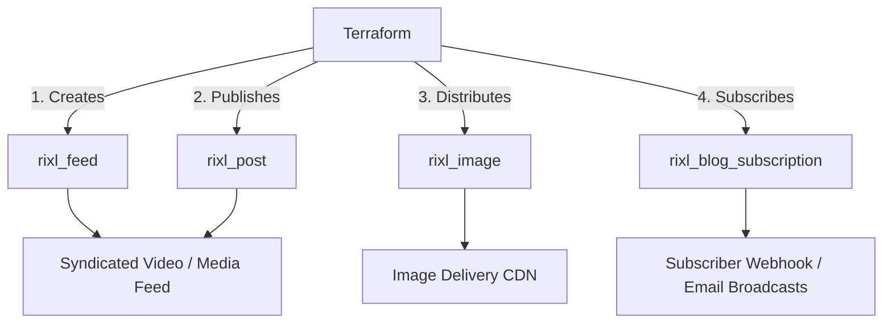

# Content Feeds, Playlists, and Media Distribution with Terraform

Modern media platforms require structured categorization to syndicate video and image assets across web applications, mobile apps, OTT devices, and subscriber channels.

The **Rixl Terraform Provider** enables media architects and content operations teams to define media feeds, curate video channels, publish rich media posts, distribute responsive image assets, and configure automated blog notifications as code.

---

## Architecture Overview



---

## 1. Defining Media Feeds (Channels & Playlists)

A **feed** serves as a curated channel or playlist within a Rixl project. Feeds can enforce media type constraints (videos, images, or both) and provide syndication endpoints for player applications:

```terraform
variable "project_id" {
  type        = string
  description = "Rixl Project ID"
}

# Create a featured video feed
resource "rixl_feed" "featured_videos" {
  project_id   = var.project_id
  name         = "featured-series"
  description  = "Weekly featured episodic video releases"
  allow_videos = true
  allow_images = false
}

# Create a mixed-media social feed
resource "rixl_feed" "community_feed" {
  project_id   = var.project_id
  name         = "community-updates"
  description  = "Product release announcements and developer demos"
  allow_videos = true
  allow_images = true
}

output "featured_feed_id" {
  value       = rixl_feed.featured_videos.id
  description = "Identifier of the featured video feed"
}
```

### Inspecting Feed Analytics

Retrieve feed engagement metrics, view counts, and top-performing feeds using data sources:

```terraform
# Query specific feed details
data "rixl_feed" "selected" {
  feed_id    = rixl_feed.featured_videos.id
  project_id = var.project_id
}

# Query top-performing feeds in the project
data "rixl_top_feeds" "trending" {
  project_id = var.project_id
}
```

---

## 2. Publishing Rich Media Posts

Use `rixl_post` to publish articles, release notes, or multimedia announcements within a project or feed:

```terraform
resource "rixl_post" "launch_announcement" {
  project_id = var.project_id
  title      = "Introducing Next-Gen HLS Video Streaming"
  content    = "Learn how our automated transcoding pipeline delivers sub-second adaptive bitrate streaming globally."
  status     = "published"
}

# Query post statistics
data "rixl_post_stats" "launch_metrics" {
  post_id    = rixl_post.launch_announcement.id
  project_id = var.project_id
}
```

---

## 3. Managing Image Assets

In addition to video streaming, Rixl provides optimized image asset storage and delivery with automated thumbnail generation:

```terraform
resource "rixl_image" "hero_banner" {
  project_id = var.project_id
  file_path  = "${path.module}/assets/hero-banner.png"
  alt_text   = "Rixl Video Streaming Platform Architecture"
}

output "hero_image_id" {
  value       = rixl_image.hero_banner.id
  description = "Identifier of the uploaded image asset"
}
```

---

## 4. Automating Subscriber Notifications

Keep platform audiences and downstream webhook consumers notified of new media publications using `rixl_blog_subscription`:

```terraform
resource "rixl_blog_subscription" "newsletter" {
  project_id = var.project_id
  email      = "updates@example.com"
  active     = true
}

data "rixl_blog_subscription" "newsletter_status" {
  subscription_id = rixl_blog_subscription.newsletter.id
  project_id      = var.project_id
}
```

---

## Complete Media Distribution Pipeline

The following configuration demonstrates an integrated media distribution environment with an isolated project, featured feed, rich post, and subscriber notifications:

```terraform
terraform {
  required_version = ">= 1.5.0"
  required_providers {
    rixl = {
      source  = "rixlhq/rixl"
      version = "~> 1.7"
    }
  }
}

provider "rixl" {
  api_key = var.rixl_api_key
}

variable "rixl_api_key" {
  type        = string
  sensitive   = true
  description = "Rixl API Key"
}

variable "org_id" {
  type        = string
  description = "Rixl Organization ID"
}

# 1. Project container
resource "rixl_project" "media_hub" {
  org_id = var.org_id
  name   = "media-hub-production"
}

# 2. Curated video channel
resource "rixl_feed" "episodes" {
  project_id   = rixl_project.media_hub.id
  name         = "season-1"
  description  = "Season 1 full episodes in multi-bitrate HLS"
  allow_videos = true
  allow_images = false
}

# 3. Accompanying post
resource "rixl_post" "episode_one_notes" {
  project_id = rixl_project.media_hub.id
  title      = "Episode 1: Architecture Deep Dive"
  content    = "Explore the video transcoding engine and global edge CDN architecture."
  status     = "published"
}

# 4. Audience notification hook
resource "rixl_blog_subscription" "audience_hook" {
  project_id = rixl_project.media_hub.id
  email      = "media-team@example.com"
  active     = true
}
```

---

## Best Practices for Media Distribution

1. **Feed Categorization**: Segregate high-volume user uploads from curated editorial channels using separate `rixl_feed` resources.
2. **Media Type Constraints**: Enforce `allow_videos` and `allow_images` flags to ensure clients consume consistent payload types.
3. **Data Source Telemetry**: Use `rixl_top_feeds` and `rixl_top_posts` to dynamically monitor viewership patterns and feed engagement.
4. **Environment Scoping**: Keep testing feeds within staging projects to avoid polluting public subscriber syndication feeds.
