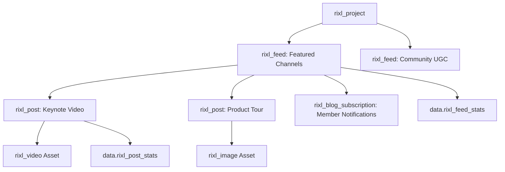

# Content Feeds, Playlists, and Media Distribution

Rixl enables platforms to organize media assets into logical channels, categorized playlists, and rich multimedia posts. Using the **Rixl Terraform Provider**, content operations teams can programmatically define feed hierarchies, enforce content moderation settings (allowing or disallowing videos and images), and manage blog subscriber notifications.

---

## Architecture Overview



---

## 1. Creating and Structuring Feeds

Feeds serve as the primary container for organizing and categorizing media content. You can restrict the types of media accepted by setting `allow_videos` and `allow_images`.

```terraform
variable "project_id" {
  type        = string
  description = "Rixl Project ID"
}

# Editorial channel restricted to video content
resource "rixl_feed" "featured_videos" {
  project_id   = var.project_id
  name         = "featured-videos"
  description  = "Curated high-production video showcase"
  allow_videos = true
  allow_images = false
}

# Mixed multimedia community feed
resource "rixl_feed" "community_announcements" {
  project_id   = var.project_id
  name         = "community-announcements"
  description  = "Community news, updates, and photo galleries"
  allow_videos = true
  allow_images = true
}

# Query metadata and performance for a feed
data "rixl_feed_stats" "featured_stats" {
  feed_id = rixl_feed.featured_videos.id
}
```

---

## 2. Publishing Media Posts

Use `rixl_post` to publish articles, release notes, or multimedia announcements within a project feed:

```terraform
resource "rixl_post" "launch_announcement" {
  project_id  = var.project_id
  feed_id     = rixl_feed.featured_videos.id
  video_id    = rixl_video.keynote.id
  description = "Watch the keynote replay covering our automated transcoding pipeline and media delivery."
}

# Query post statistics
data "rixl_post_stats" "launch_metrics" {
  post_id = rixl_post.launch_announcement.id
}
```

---

## 3. Managing Image Assets

In addition to video streaming, Rixl provides optimized image asset storage and delivery with automated thumbnail and thumbhash generation:

```terraform
resource "rixl_image" "hero_banner" {
  project_id = var.project_id
  name       = "conference-hero-2026"
  file_path  = "${path.module}/images/hero_banner.png"
}

output "image_aspect_ratio" {
  value       = rixl_image.hero_banner.aspect_ratio
  description = "Computed aspect ratio of uploaded image"
}

output "image_blur_thumbhash" {
  value       = rixl_image.hero_banner.thumbhash
  description = "Instant blur-up placeholder hash for UI rendering"
}
```

---

## 4. Managing Blog & Content Subscriptions

Manage user notification preferences for content channels using `rixl_blog_subscription`:

```terraform
variable "user_id" {
  type        = string
  description = "Rixl User ID"
}

resource "rixl_blog_subscription" "user_newsletter" {
  user_id    = var.user_id
  subscribed = true
}
```

---

## 5. Production Syndication Template

Below is a complete Terraform configuration combining a project, multiple categorized feeds, videos, images, and posts:

```terraform
terraform {
  required_version = ">= 1.5.0"
  required_providers {
    rixl = {
      source  = "rixlhq/rixl"
      version = "~> 1.8.0"
    }
  }
}

provider "rixl" {
  api_key = var.rixl_api_key
}

variable "rixl_api_key" {
  type      = string
  sensitive = true
}

variable "org_id" {
  type = string
}

# 1. Project environment
resource "rixl_project" "media_hub" {
  org_id = var.org_id
  name   = "media-syndication-hub"
}

# 2. Main video showcase feed
resource "rixl_feed" "showcase" {
  project_id   = rixl_project.media_hub.id
  name         = "main-showcase"
  description  = "Primary video showcase channel"
  allow_videos = true
  allow_images = false
}

# 3. Photo & banner gallery feed
resource "rixl_feed" "gallery" {
  project_id   = rixl_project.media_hub.id
  name         = "photo-gallery"
  description  = "Photography and poster gallery"
  allow_videos = false
  allow_images = true
}

# 4. Upload featured media
resource "rixl_video" "showcase_video" {
  project_id       = rixl_project.media_hub.id
  name             = "annual-highlights"
  file_path        = "${path.module}/media/highlights.mp4"
  poster_file_path = "${path.module}/media/highlights_poster.jpg"
}

resource "rixl_image" "gallery_cover" {
  project_id = rixl_project.media_hub.id
  name       = "annual-cover-art"
  file_path  = "${path.module}/images/cover.jpg"
}

# 5. Publish posts into feeds
resource "rixl_post" "video_post" {
  project_id  = rixl_project.media_hub.id
  feed_id     = rixl_feed.showcase.id
  video_id    = rixl_video.showcase_video.id
  description = "Watch the annual highlights recap video."
}

resource "rixl_post" "image_post" {
  project_id  = rixl_project.media_hub.id
  feed_id     = rixl_feed.gallery.id
  image_id    = rixl_image.gallery_cover.id
  description = "Official cover artwork for the annual media release."
}

# 6. Outputs
output "showcase_feed_id" {
  value = rixl_feed.showcase.id
}

output "video_playback_url" {
  value = rixl_video.showcase_video.playback_url
}
```

---

## Best Practices

1. **Feed Categorization**: Segregate high-volume user uploads from curated editorial channels using separate `rixl_feed` resources.
2. **Media Type Constraints**: Enforce `allow_videos` and `allow_images` flags to ensure clients consume consistent payload types.
3. **Data Source Telemetry**: Use `rixl_top_feeds` and `rixl_top_posts` to dynamically monitor viewership patterns and feed engagement.
4. **Environment Scoping**: Keep testing feeds within staging projects to avoid polluting public subscriber syndication feeds.

---

## Next Steps & Related Guides

- [Getting Started with Rixl](getting-started) &mdash; Initial provider configuration and project provisioning.
- [Automated Video Streaming Pipeline](video-streaming-pipeline) &mdash; Uploading videos, generating HLS streams, and adding subtitles.
- [Custom Domains and Auto-Join Management](custom-domains) &mdash; Organization domain verification, project domain associations, and corporate email auto-join policies.
- [Observability, Telemetry, and Analytics](monitoring-and-analytics) &mdash; Tracking media bandwidth and viewer metrics.
