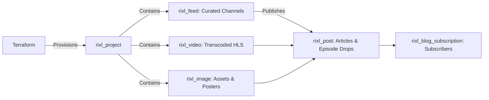

# Content Feeds, Playlists, and Media Distribution

Publishing video infrastructure is only half of modern streaming architecture; organizing content into structured feeds, curated playlists, and multimedia articles is essential for audience discovery and retention.

The **Rixl Terraform Provider** allows you to declare content feeds, syndicate rich media posts, host responsive images, and manage subscriber preferences as code.

---

## Media Syndication Architecture



---

## 1. Declaring Content Feeds & Channels

Define feeds to organize video series, podcast channels, or community submissions:

```terraform
variable "project_id" {
  type        = string
  description = "Rixl Project ID"
}

# Create a curated video feed
resource "rixl_feed" "featured_videos" {
  project_id   = var.project_id
  name         = "featured-shows"
  description  = "High-priority curated video series and documentaries"
  allow_videos = true
  allow_images = false
  has_likes    = true
  has_shares   = true
  has_comments = true
}

# Create a mixed-media social feed
resource "rixl_feed" "community_feed" {
  project_id   = var.project_id
  name         = "community-updates"
  description  = "Product release announcements and developer demos"
  allow_videos = true
  allow_images = true
}

output "featured_feed_id" {
  value       = rixl_feed.featured_videos.id
  description = "Identifier of the featured video feed"
}
```

### Inspecting Feed Analytics

Retrieve feed engagement metrics, view counts, and top-performing feeds using data sources:

```terraform
# Query specific feed details
data "rixl_feed" "selected" {
  project_id = var.project_id
  id         = rixl_feed.featured_videos.id
}

# Query top-performing feeds in the project
data "rixl_top_feeds" "trending" {
  project_id = var.project_id
}
```

---

## 2. Publishing Rich Media Posts

Use `rixl_post` to publish articles, release notes, or multimedia announcements within a project feed:

```terraform
resource "rixl_post" "launch_announcement" {
  project_id  = var.project_id
  feed_id     = rixl_feed.featured_videos.id
  video_id    = rixl_video.keynote.id
  description = "Watch the keynote replay covering our automated transcoding pipeline and global CDN distribution."
}

# Query post statistics
data "rixl_post_stats" "launch_metrics" {
  post_id = rixl_post.launch_announcement.id
}
```

---

## 3. Managing Image Assets

In addition to video streaming, Rixl provides optimized image asset storage and delivery with automated thumbnail and thumbhash generation:

```terraform
resource "rixl_image" "hero_banner" {
  project_id = var.project_id
  name       = "hero-architecture-diagram"
  file_path  = "${path.module}/assets/hero-banner.png"
}

output "hero_image_id" {
  value       = rixl_image.hero_banner.id
  description = "Identifier of the uploaded image asset"
}
```

---

## 4. Automating Subscriber Notifications

Manage platform notification preferences and blog updates using `rixl_blog_subscription`:

```terraform
variable "user_id" {
  type        = string
  description = "Rixl User ID"
}

resource "rixl_blog_subscription" "newsletter" {
  user_id    = var.user_id
  subscribed = true
}

data "rixl_blog_subscription" "newsletter_status" {
  user_id = var.user_id
}
```

---

## Complete Media Distribution Pipeline

The following configuration demonstrates an integrated media distribution environment with an isolated project, featured feed, rich post, and subscriber notifications:

```terraform
terraform {
  required_version = ">= 1.5.0"
  required_providers {
    rixl = {
      source  = "rixlhq/rixl"
      version = "~> 1.7"
    }
  }
}

provider "rixl" {
  api_key = var.rixl_api_key
}

variable "rixl_api_key" {
  type        = string
  sensitive   = true
  description = "Rixl API Key"
}

variable "org_id" {
  type        = string
  description = "Rixl Organization ID"
}

variable "user_id" {
  type        = string
  description = "Rixl User ID"
}

# 1. Project container
resource "rixl_project" "media_hub" {
  org_id = var.org_id
  name   = "media-hub-production"
}

# 2. Curated video channel
resource "rixl_feed" "episodes" {
  project_id   = rixl_project.media_hub.id
  name         = "season-1"
  description  = "Season 1 full episodes in multi-bitrate HLS"
  allow_videos = true
  allow_images = false
}

# 3. Master video upload
resource "rixl_video" "episode_one" {
  project_id = rixl_project.media_hub.id
  name       = "episode-01-master"
  file_path  = "${path.module}/media/ep01.mp4"
}

# 4. Accompanying post
resource "rixl_post" "episode_one_notes" {
  project_id  = rixl_project.media_hub.id
  feed_id     = rixl_feed.episodes.id
  video_id    = rixl_video.episode_one.id
  description = "Season 1, Episode 1: Cloud Transcoding Architecture deep dive."
}

# 5. Audience notification preference
resource "rixl_blog_subscription" "audience_hook" {
  user_id    = var.user_id
  subscribed = true
}
```

---

## Best Practices for Media Distribution

1. **Feed Categorization**: Segregate high-volume user uploads from curated editorial channels using separate `rixl_feed` resources.
2. **Media Type Constraints**: Enforce `allow_videos` and `allow_images` flags to ensure clients consume consistent payload types.
3. **Data Source Telemetry**: Use `rixl_top_feeds` and `rixl_top_posts` to dynamically monitor viewership patterns and feed engagement.
4. **Environment Scoping**: Keep testing feeds within staging projects to avoid polluting public subscriber syndication feeds.

---

## Next Steps & Related Guides

- [Getting Started with Rixl](getting-started) &mdash; Initial provider configuration and project provisioning.
- [Automated Video Streaming Pipeline](video-streaming-pipeline) &mdash; Uploading videos, generating HLS streams, and adding subtitles.
- [Custom CDN Streaming Domains and SSL Automation](custom-domains-and-cdn) &mdash; Vanity streaming domains and DNS verification.
- [Observability, Telemetry, and Analytics](monitoring-and-analytics) &mdash; Tracking CDN bandwidth and viewer metrics.
