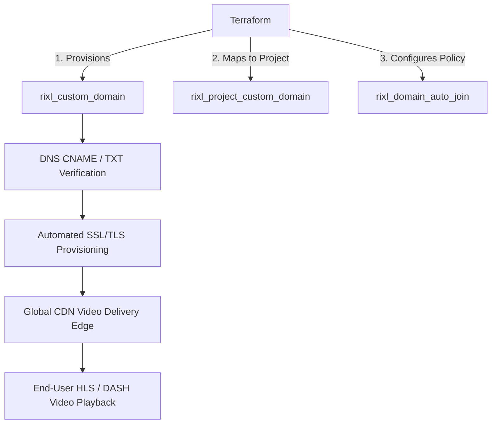

# Custom CDN Streaming Domains and SSL Automation with Terraform

Delivering video content under your brand's vanity domain (e.g., `stream.company.com` or `media.example.org`) builds audience trust, aligns with corporate security policies, and simplifies content delivery network (CDN) routing.

The **Rixl Terraform Provider** enables platform and media engineers to provision custom streaming domains, manage automated SSL/TLS certificate validation, bind domains to specific project environments, and configure corporate email domain auto-join policies entirely through code.

---

## Architecture Overview



---

## 1. Registering a Custom Streaming Domain

To register a custom domain within your Rixl organization, declare a `rixl_custom_domain` resource. Rixl provisions edge CDN endpoints and issues verification records for automated TLS certificate issuance.

```terraform
variable "org_id" {
  type        = string
  description = "Rixl Organization ID"
}

# Register the custom streaming domain
resource "rixl_custom_domain" "streaming" {
  org_id = var.org_id
  domain = "stream.example.com"
}

output "custom_domain_id" {
  value       = rixl_custom_domain.streaming.id
  description = "Identifier of the custom streaming domain"
}
```

### DNS Verification & Verification Lookup

After provisioning the resource, retrieve DNS verification tokens using the `rixl_domain` data source to populate your DNS provider (Route 53, Cloudflare, Google Cloud DNS, Azure DNS, etc.):

```terraform
data "rixl_domain" "streaming_status" {
  domain = rixl_custom_domain.streaming.domain
}

output "domain_verified" {
  value       = data.rixl_domain.streaming_status.status
  description = "Current verification status of the custom domain"
}
```

---

## 2. Binding Custom Domains to Streaming Projects

To prevent cross-tenant traffic leakage and ensure strict environment isolation, bind custom domains to specific Rixl projects using `rixl_project_custom_domain`:

```terraform
# Create isolated project environment
resource "rixl_project" "media_prod" {
  org_id = var.org_id
  name   = "production-vod"
}

# Bind custom domain to the production project
resource "rixl_project_custom_domain" "prod_mapping" {
  project_id = rixl_project.media_prod.id
  domain_id  = rixl_custom_domain.streaming.id
}
```

Once mapped, all HLS manifests (`.m3u8`), video segments (`.ts` / `.m4s`), poster images, and subtitle tracks uploaded in `rixl_project.media_prod` will be delivered via `https://stream.example.com/...`.

---

## 3. Configuring Corporate Email Domain Auto-Join Policies

When onboarding team members or content creators, you can allow any user with a verified corporate email address (e.g., `@example.com`) to automatically join your Rixl organization with a predefined role:

```terraform
# Configure automated corporate onboarding
resource "rixl_domain_auto_join" "corp_onboarding" {
  org_id    = var.org_id
  domain    = "example.com"
  role_name = "Editor"
}
```

Inspect the auto-join configuration with the `rixl_domain_auto_join` data source:

```terraform
data "rixl_domain_auto_join" "corp_status" {
  domain = "example.com"
}
```

---

## Complete Multi-Environment Example

Below is a complete Terraform configuration provisioning custom domains across staging and production environments:

```terraform
terraform {
  required_version = ">= 1.5.0"
  required_providers {
    rixl = {
      source  = "rixlhq/rixl"
      version = "~> 1.7"
    }
  }
}

provider "rixl" {
  api_key = var.rixl_api_key
}

variable "rixl_api_key" {
  type        = string
  sensitive   = true
  description = "Rixl API Key"
}

variable "org_id" {
  type        = string
  description = "Rixl Organization ID"
}

# Production Domain & Project
resource "rixl_custom_domain" "prod_cdn" {
  org_id = var.org_id
  domain = "video.example.com"
}

resource "rixl_project" "prod_project" {
  org_id = var.org_id
  name   = "prod-media-delivery"
}

resource "rixl_project_custom_domain" "prod_binding" {
  project_id = rixl_project.prod_project.id
  domain_id  = rixl_custom_domain.prod_cdn.id
}

# Staging Domain & Project
resource "rixl_custom_domain" "staging_cdn" {
  org_id = var.org_id
  domain = "staging-video.example.com"
}

resource "rixl_project" "staging_project" {
  org_id = var.org_id
  name   = "staging-media-delivery"
}

resource "rixl_project_custom_domain" "staging_binding" {
  project_id = rixl_project.staging_project.id
  domain_id  = rixl_custom_domain.staging_cdn.id
}
```

---

## Best Practices for Custom Video Domains

1. **CNAME Before Cutover**: Point your DNS CNAME record to Rixl's edge CDN endpoint prior to mapping domains to production feeds to ensure zero playback downtime.
2. **Automated TLS Renewals**: Rixl manages certificate renewals automatically once DNS ownership is verified.
3. **Environment Separation**: Maintain distinct vanity subdomains (e.g., `video.example.com` vs `staging-video.example.com`) mapped to separate Rixl projects.
4. **Combined with IAM**: Pair custom domains with `rixl_access_policy` to control which team members and service accounts have rights to alter domain routing.
