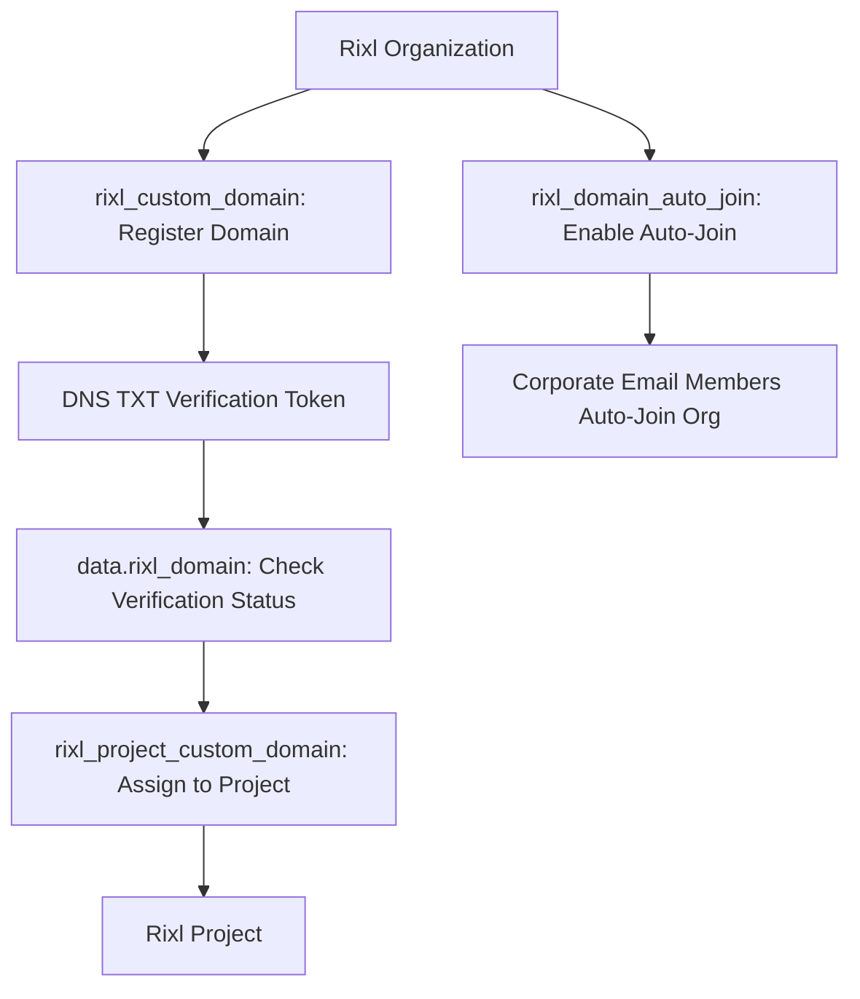

# Custom Domains and Auto-Join Management

Rixl allows organizations to configure branded custom domains for their projects and enforce email-based auto-join policies for company members. Using the **Rixl Terraform Provider**, platform administrators can automate custom domain registration, read domain verification tokens, associate verified domains with projects, and manage organization membership access.

---

## Architectural Flow

The diagram below illustrates how custom domains and auto-join policies interact with Rixl organizations and projects:



---

## Complete Configuration Example

Below is a complete, production-ready configuration managing organization domains, project domain assignment, and domain auto-join policies:

```terraform
terraform {
  required_version = ">= 1.5.0"
  required_providers {
    rixl = {
      source  = "rixlhq/rixl"
      version = "~> 1.8.0"
    }
  }
}

provider "rixl" {
  api_key = var.rixl_api_key
}

variable "rixl_api_key" {
  type        = string
  sensitive   = true
  description = "Rixl API Key for authentication"
}

variable "rixl_org_id" {
  type        = string
  description = "Target Rixl Organization ID"
}

# 1. Define a container project
resource "rixl_project" "media" {
  org_id = var.rixl_org_id
  name   = "Enterprise Media Portal"
}

# 2. Register organization custom domain
resource "rixl_custom_domain" "company_domain" {
  org_id = var.rixl_org_id
  domain = "media.acme.corp"
}

# 3. Read domain verification token and status
data "rixl_domain" "company_domain_status" {
  org_id     = var.rixl_org_id
  depends_on = [rixl_custom_domain.company_domain]
}

# 4. Associate the verified custom domain with the project
resource "rixl_project_custom_domain" "project_domain" {
  org_id        = var.rixl_org_id
  project_id    = rixl_project.media.id
  custom_domain = rixl_custom_domain.company_domain.domain
}

# 5. Enable auto-join for users with corporate email matching the verified domain
resource "rixl_domain_auto_join" "corp_auto_join" {
  org_id  = var.rixl_org_id
  enabled = true

  depends_on = [rixl_custom_domain.company_domain]
}

# 6. Read auto-join policy state
data "rixl_domain_auto_join" "current_auto_join" {
  org_id     = var.rixl_org_id
  depends_on = [rixl_domain_auto_join.corp_auto_join]
}

# Outputs for DNS verification and operational audits
output "verification_token" {
  description = "Token required in DNS TXT record for domain verification"
  value       = data.rixl_domain.company_domain_status.status.pending.verification_token
}

output "verification_token_expires_at" {
  description = "Expiration timestamp for the DNS verification token"
  value       = data.rixl_domain.company_domain_status.status.pending.expires_at
}

output "project_custom_domain" {
  description = "Custom domain assigned to the project"
  value       = rixl_project_custom_domain.project_domain.custom_domain
}

output "auto_join_enabled" {
  description = "Current auto-join policy state"
  value       = data.rixl_domain_auto_join.current_auto_join.enabled
}
```

---

## Operational Workflow

### 1. Registering the Organization Custom Domain
Create the `rixl_custom_domain` resource with your target domain name:

```terraform
resource "rixl_custom_domain" "portal" {
  org_id = "org_01hxxxxxxxxxxxxxxxxxxxxxxx"
  domain = "media.acme.corp"
}
```

### 2. DNS Verification
Retrieve the pending verification token from the `rixl_domain` data source to populate your DNS provider:

```terraform
data "rixl_domain" "portal_verification" {
  org_id = "org_01hxxxxxxxxxxxxxxxxxxxxxxx"
}

output "txt_token" {
  value = data.rixl_domain.portal_verification.status.pending.verification_token
}
```

### 3. Associating the Domain with a Project
Once the domain is registered under the organization, bind it to a specific project using `rixl_project_custom_domain`:

```terraform
resource "rixl_project_custom_domain" "portal_binding" {
  org_id        = "org_01hxxxxxxxxxxxxxxxxxxxxxxx"
  project_id    = "proj_01hxxxxxxxxxxxxxxxxxxxxxx"
  custom_domain = "media.acme.corp"
}
```

### 4. Enabling Corporate Auto-Join
To allow team members with matching corporate email domains to automatically join the organization upon registration:

```terraform
resource "rixl_domain_auto_join" "enterprise_policy" {
  org_id  = "org_01hxxxxxxxxxxxxxxxxxxxxxxx"
  enabled = true
}
```

---

## Best Practices

1. **Verification Token Monitoring**: Use `data.rixl_domain` to track token expiration dates (`status.pending.expires_at`) to ensure DNS TXT records are added before tokens expire.
2. **Project Independence**: Multiple projects within the same organization can each have their own custom domains, provided each domain is registered under the organization.
3. **Graceful Destruction**: Removing a `rixl_project_custom_domain` unlinks the domain from the project without deleting the organization's verified domain registration.

---

## Related Documentation

- [Getting Started with Rixl](getting-started) &mdash; Initial provider configuration and authentication.
- [Automated Video Streaming Pipeline](video-streaming-pipeline) &mdash; Transcoding, captions, and playback endpoints.
- [Content Feeds, Playlists, and Media Distribution](content-feeds-and-distribution) &mdash; Organizing media feeds and posts.
- [IAM, RBAC, and Security Automation](iam-and-security) &mdash; Managing API keys and access policies.
- [Observability, Telemetry, and Analytics](monitoring-and-analytics) &mdash; Tracking bandwidth and viewer metrics.
