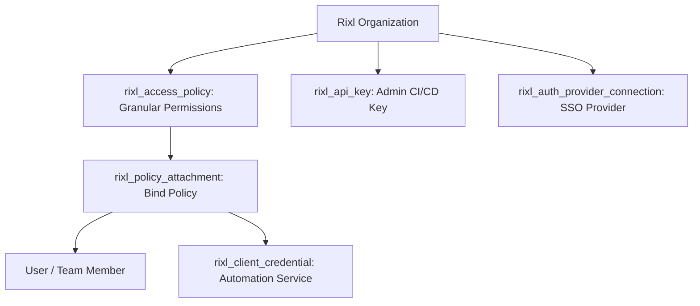

# IAM, RBAC, and Security Automation

Securing media assets, publishing workflows, and administrative operations requires strict least-privilege access controls. The **Rixl Terraform Provider** allows organizations to manage granular role-based access control (RBAC) policies, bind policies to identities, provision machine-to-machine OAuth2 client credentials, and configure external identity provider connections.

---

## Architecture Overview



---

## 1. Defining Granular Access Policies

Define fine-grained IAM policies specifying exact allowable actions using the `permissions` list:

```terraform
variable "org_id" {
  type        = string
  description = "Rixl Organization ID"
}

# Video Ingest Operator Policy
resource "rixl_access_policy" "video_ingest_operator" {
  org_id      = var.org_id
  name        = "Video Ingestion Operator"
  description = "Allows uploading and transcoding video assets and chapters"

  permissions = [
    "videos:create",
    "videos:read",
    "videos:chapters:create",
    "videos:chapters:read",
    "subtitles:create",
    "subtitles:read",
  ]
}

# Read-only Telemetry & Analytics Policy
resource "rixl_access_policy" "analytics_viewer" {
  org_id      = var.org_id
  name        = "Analytics Viewer"
  description = "Permits reading dashboards and playback statistics"

  permissions = [
    "dashboards:read",
    "analytics:read",
    "realtime:read",
  ]
}
```

---

## 2. Binding Policies with Policy Attachments

Attach access policies to users or client credentials using `rixl_policy_attachment`:

```terraform
variable "target_user_id" {
  type        = string
  description = "User ID to grant video ingestion permissions"
}

resource "rixl_policy_attachment" "operator_attachment" {
  org_id        = var.org_id
  policy_id     = rixl_access_policy.video_ingest_operator.id
  identity_id   = var.target_user_id
  identity_type = "POLICY_IDENTITY_TYPE_USER"
}
```

---

## 3. Provisioning Machine-to-Machine (M2M) OAuth2 Credentials

For automated backend services and CI/CD pipelines, provision short-lived, self-refreshing OAuth2 client credentials:

```terraform
resource "rixl_client_credential" "backend_encoder_service" {
  name = "backend-encoder-service"
}

output "m2m_client_id" {
  value       = rixl_client_credential.backend_encoder_service.client_id
  description = "OAuth2 Client ID for backend SDK authentication"
}

output "m2m_client_secret" {
  value       = rixl_client_credential.backend_encoder_service.client_secret
  sensitive   = true
  description = "OAuth2 Client Secret (store securely in vault)"
}
```

---

## 4. API Key Management

Generate organization-scoped API keys for platform administrators or infrastructure provisioning:

```terraform
resource "rixl_api_key" "deployer_key" {
  name = "terraform-production-deployer"
}

output "deployer_api_key_secret" {
  value       = rixl_api_key.deployer_key.secret
  sensitive   = true
  description = "API Key secret value (available only at creation)"
}
```

---

## 5. Enterprise Single Sign-On (SSO) Connection

Connect enterprise identity providers to enforce centralized authentication:

```terraform
resource "rixl_auth_provider_connection" "google_oauth" {
  id    = "EXTERNAL_ACCOUNT_PROVIDER_GOOGLE"
  token = var.google_oauth_provider_token
}
```

---

## 6. Next Steps & Architecture Guides

- [Getting Started with Rixl](getting-started) &mdash; Initial provider configuration and project provisioning.
- [Automated Video Streaming Pipeline](video-streaming-pipeline) &mdash; Uploading videos, generating HLS streams, and adding subtitles.
- [Custom Domains and Auto-Join Management](custom-domains) &mdash; Organization domain verification, project domain associations, and corporate email auto-join policies.
- [Observability, Telemetry, and Analytics](monitoring-and-analytics) &mdash; Tracking media bandwidth and viewer metrics.
