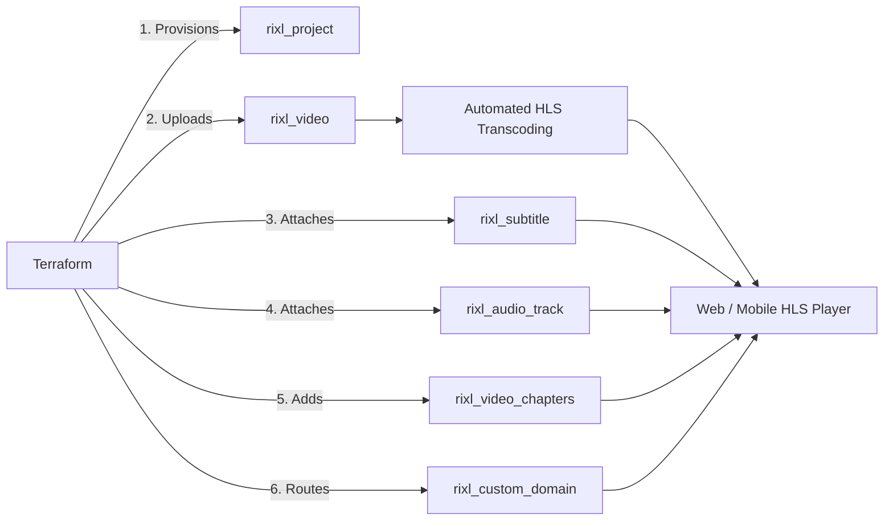

# Building an Automated Video Streaming Pipeline with Terraform

Rixl provides automated, scalable video infrastructure. When video assets are uploaded via the Terraform provider, Rixl's processing pipeline automatically transcodes source files into adaptive multi-bitrate HLS (HTTP Live Streaming), generates video poster thumbnails, and provisions CDN endpoints.

This guide demonstrates how to orchestrate a production-ready video distribution pipeline entirely in Terraform.

---

## Architecture Overview



---

## 1. Project and Custom Domain Setup

Isolate video streaming workloads within dedicated projects and link a verified custom streaming domain:

```terraform
variable "org_id" {
  type        = string
  description = "Rixl Organization ID"
}

# Create a project environment
resource "rixl_project" "vod" {
  org_id = var.org_id
  name   = "vod-production"
}

# Attach a branded streaming domain
resource "rixl_custom_domain" "vod_cdn" {
  org_id = var.org_id
  domain = "vod.media.example.com"
}

resource "rixl_project_custom_domain" "vod_cdn_mapping" {
  org_id        = var.org_id
  project_id    = rixl_project.vod.id
  custom_domain = rixl_custom_domain.vod_cdn.domain
}
```

---

## 2. Uploading Source Video and Poster

Upload the master video file along with an optional custom thumbnail poster. Rixl immediately begins encoding 1080p, 720p, 480p, and 360p HLS profiles:

```terraform
resource "rixl_video" "masterclass" {
  project_id       = rixl_project.vod.id
  name             = "masterclass-episode-01"
  file_path        = "${path.module}/media/episode01_master.mp4"
  poster_file_path = "${path.module}/media/episode01_poster.jpg"
  visibility       = "public"
}
```

---

## 3. Adding Multi-Language Subtitles

Attach localized WebVTT subtitle files for international audiences and accessibility compliance:

```terraform
# English Subtitles (Default)
resource "rixl_subtitle" "sub_en" {
  project_id    = rixl_project.vod.id
  video_id      = rixl_video.masterclass.id
  label         = "English Captions"
  language_code = "en"
  file_path     = "${path.module}/media/subtitles/en.vtt"
}

# Spanish Subtitles
resource "rixl_subtitle" "sub_es" {
  project_id    = rixl_project.vod.id
  video_id      = rixl_video.masterclass.id
  label         = "Subtítulos en Español"
  language_code = "es"
  file_path     = "${path.module}/media/subtitles/es.vtt"
}

# German Subtitles
resource "rixl_subtitle" "sub_de" {
  project_id    = rixl_project.vod.id
  video_id      = rixl_video.masterclass.id
  label         = "Deutsche Untertitel"
  language_code = "de"
  file_path     = "${path.module}/media/subtitles/de.vtt"
}
```

---

## 4. Attaching Alternative Audio Dubs

Provide multi-lingual audio tracks or director commentary:

```terraform
resource "rixl_audio_track" "dub_es" {
  project_id    = rixl_project.vod.id
  video_id      = rixl_video.masterclass.id
  label         = "Spanish Audio Dub"
  language_code = "es"
  file_path     = "${path.module}/media/audio/dub_es.m4a"
}
```

---

## 5. Configuring Interactive Player Chapters

Enable viewers to jump between timeline segments and browse topics:

```terraform
resource "rixl_video_chapters" "masterclass_chapters" {
  project_id = rixl_project.vod.id
  video_id   = rixl_video.masterclass.id

  chapters = [
    {
      title          = "Welcome & Overview"
      start_time_sec = 0.0
    },
    {
      title          = "Foundational Concepts"
      start_time_sec = 145.0
    },
    {
      title          = "Hands-On Implementation"
      start_time_sec = 420.5
    },
    {
      title          = "Q&A and Key Takeaways"
      start_time_sec = 980.0
    }
  ]
}
```

---

## 6. Outputs for Frontend Players

Expose video metadata and HLS manifest references for web players (Video.js, HLS.js, Apple AVPlayer, ExoPlayer):

```terraform
output "video_id" {
  value       = rixl_video.masterclass.id
  description = "The unique identifier of the processed video asset"
}

output "video_duration" {
  value       = rixl_video.masterclass.duration
  description = "Total video duration"
}

output "video_resolution" {
  value       = "${rixl_video.masterclass.width}x${rixl_video.masterclass.height}"
  description = "Source resolution dimensions"
}
```

---

## 7. Next Steps & Architecture Guides

- [Custom CDN Streaming Domains and SSL Automation](custom-domains-and-cdn) &mdash; Set up branded playback domains and automated SSL.
- [Content Feeds, Playlists, and Media Distribution](content-feeds-and-distribution) &mdash; Organize videos into channels and playlists.
- [Observability, Telemetry, and Analytics](monitoring-and-analytics) &mdash; Monitor video engagement heatmaps and real-time playback sessions.
- [IAM, RBAC, and Security Automation](iam-and-security) &mdash; Restrict video upload permissions with least-privilege IAM policies.
