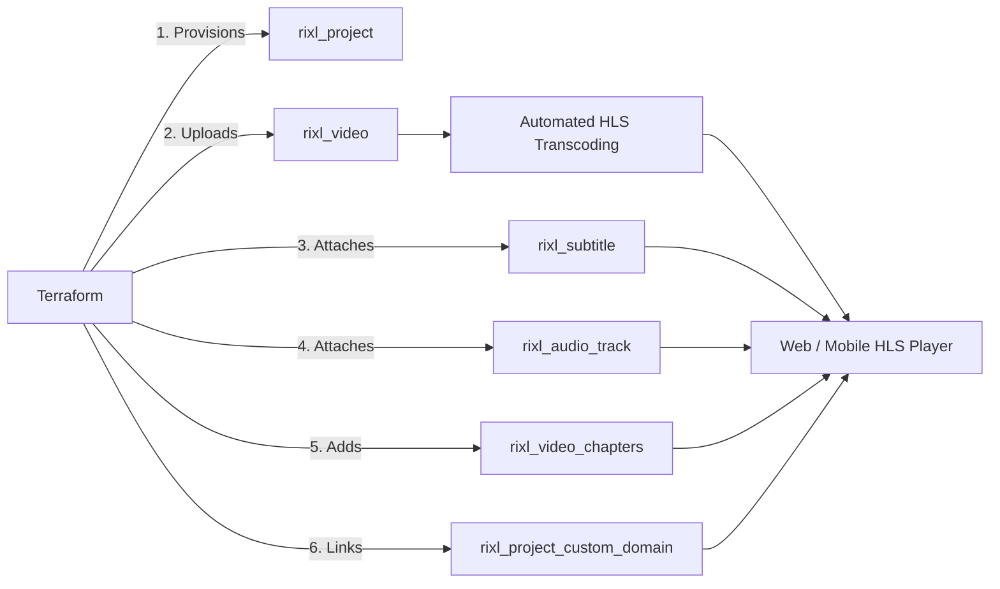

# Building an Automated Video Streaming Pipeline with Terraform

Rixl provides automated, scalable video infrastructure. When video assets are uploaded via the Terraform provider, Rixl's processing pipeline automatically transcodes source files into adaptive multi-bitrate HLS (HTTP Live Streaming), generates video poster thumbnails, and generates playback endpoints.

This guide demonstrates how to orchestrate a production-ready video pipeline entirely in Terraform.

---

## Architecture Overview



---

## 1. Project and Custom Domain Setup

Isolate video streaming workloads within dedicated projects and link a verified custom domain:

```terraform
variable "org_id" {
  type        = string
  description = "Rixl Organization ID"
}

# Create a project environment
resource "rixl_project" "vod" {
  org_id = var.org_id
  name   = "vod-production"
}

# Attach a branded custom domain
resource "rixl_custom_domain" "vod_domain" {
  org_id = var.org_id
  domain = "vod.media.example.com"
}

resource "rixl_project_custom_domain" "vod_domain_mapping" {
  org_id        = var.org_id
  project_id    = rixl_project.vod.id
  custom_domain = rixl_custom_domain.vod_domain.domain
}
```

---

## 2. Uploading Source Video and Poster

Upload the master video file along with an optional custom thumbnail poster. Rixl immediately begins encoding adaptive bitrate HLS profiles:

```terraform
resource "rixl_video" "masterclass" {
  project_id       = rixl_project.vod.id
  name             = "masterclass-episode-01"
  file_path        = "${path.module}/media/episode01_master.mp4"
  poster_file_path = "${path.module}/media/episode01_poster.jpg"
}
```

---

## 3. Attaching Multi-Language Closed Captions (Subtitles)

Upload WebVTT or SRT subtitle files for international audiences:

```terraform
# English Subtitles
resource "rixl_subtitle" "sub_en" {
  project_id    = rixl_project.vod.id
  video_id      = rixl_video.masterclass.id
  label         = "English (CC)"
  language_code = "en"
  file_path     = "${path.module}/subtitles/en.vtt"
}

# Spanish Subtitles
resource "rixl_subtitle" "sub_es" {
  project_id    = rixl_project.vod.id
  video_id      = rixl_video.masterclass.id
  label         = "Español"
  language_code = "es"
  file_path     = "${path.module}/subtitles/es.vtt"
}

# German Subtitles
resource "rixl_subtitle" "sub_de" {
  project_id    = rixl_project.vod.id
  video_id      = rixl_video.masterclass.id
  label         = "Deutsch"
  language_code = "de"
  file_path     = "${path.module}/subtitles/de.vtt"
}
```

---

## 4. Multi-Track Alternate Audio Dubbing

Attach alternate localized audio tracks or director commentary:

```terraform
# French Alternate Dubbing Track
resource "rixl_audio_track" "dub_fr" {
  project_id    = rixl_project.vod.id
  video_id      = rixl_video.masterclass.id
  label         = "Français (Doublage)"
  language_code = "fr"
  file_path     = "${path.module}/audio/fr_dub.aac"
}

# Director's Commentary Track
resource "rixl_audio_track" "commentary" {
  project_id    = rixl_project.vod.id
  video_id      = rixl_video.masterclass.id
  label         = "Director Commentary"
  language_code = "en"
  file_path     = "${path.module}/audio/director_commentary.aac"
}
```

---

## 5. Timeline Chapters & Navigation Points

Define interactive chapter cues for modern video players (Video.js, HLS.js, AVPlayer, ExoPlayer):

```terraform
resource "rixl_video_chapters" "masterclass_chapters" {
  project_id = rixl_project.vod.id
  video_id   = rixl_video.masterclass.id

  chapters = [
    {
      title          = "Introduction & Core Concepts"
      start_time_sec = 0.0
    },
    {
      title          = "Architecture Deep Dive"
      start_time_sec = 184.5
    },
    {
      title          = "Hands-on Implementation"
      start_time_sec = 612.0
    },
    {
      title          = "Production Hardening & QA"
      start_time_sec = 1245.8
    },
    {
      title          = "Conclusion & Wrap-Up"
      start_time_sec = 1680.0
    },
  ]
}
```

---

## 6. Output Playback URLs and Video Metadata

Export the resulting HLS playback URLs and video attributes for downstream frontends or CMS platforms:

```terraform
output "video_id" {
  value       = rixl_video.masterclass.id
  description = "Unique identifier of the transcoded video"
}

output "video_hls_url" {
  value       = rixl_video.masterclass.playback_url
  description = "Master HLS (.m3u8) playlist URL"
}

output "video_duration_seconds" {
  value       = rixl_video.masterclass.duration_sec
  description = "Total video duration in seconds"
}

output "video_resolution" {
  value       = "${rixl_video.masterclass.width}x${rixl_video.masterclass.height}"
  description = "Source resolution dimensions"
}
```

---

## 7. Next Steps & Architecture Guides

- [Custom Domains and Auto-Join Management](custom-domains) &mdash; Organization domain verification, project domain associations, and corporate email auto-join policies.
- [Content Feeds, Playlists, and Media Distribution](content-feeds-and-distribution) &mdash; Organize videos into channels and playlists.
- [Observability, Telemetry, and Analytics](monitoring-and-analytics) &mdash; Monitor video engagement heatmaps and real-time playback sessions.
- [IAM, RBAC, and Security Automation](iam-and-security) &mdash; Restrict video upload permissions with least-privilege IAM policies.
